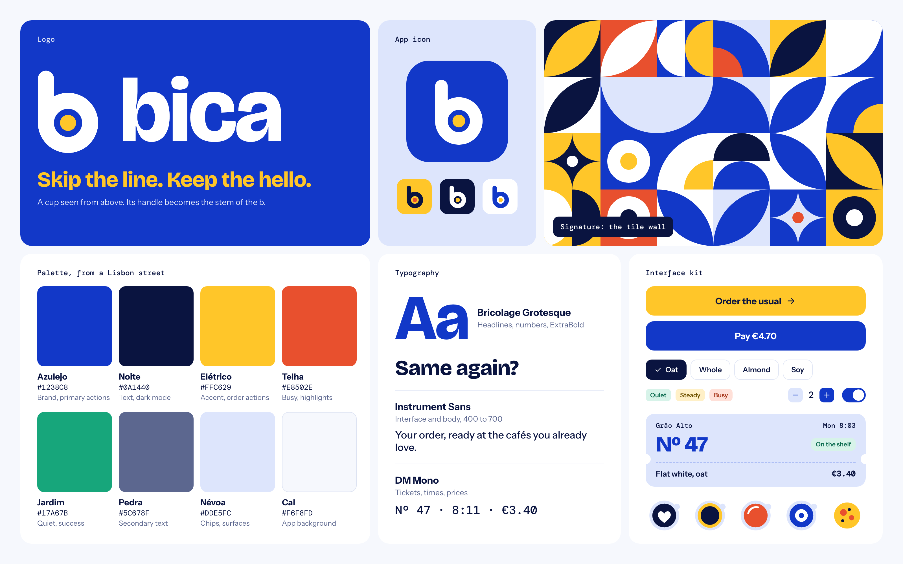
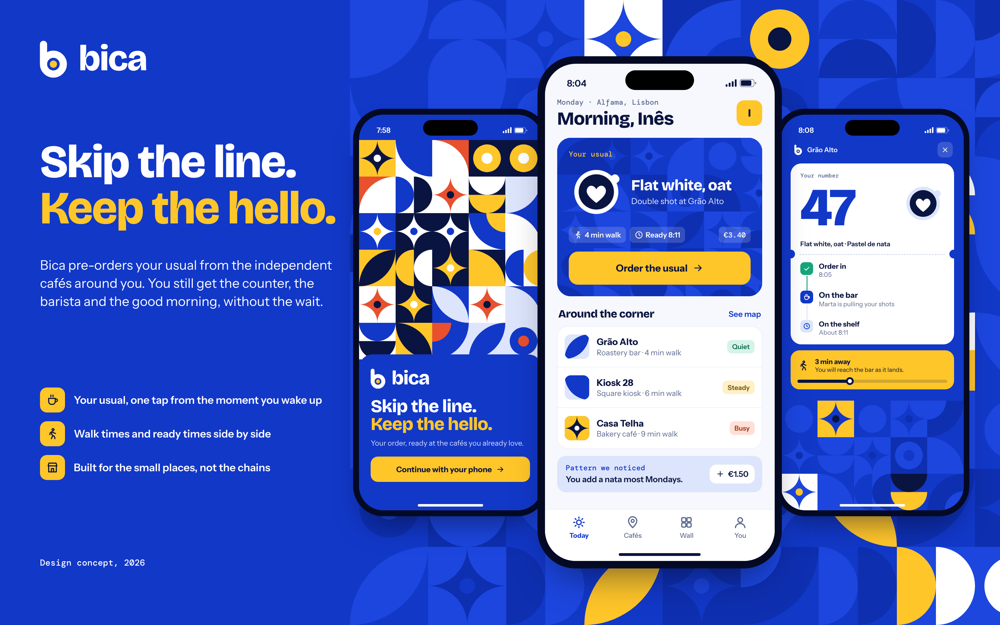
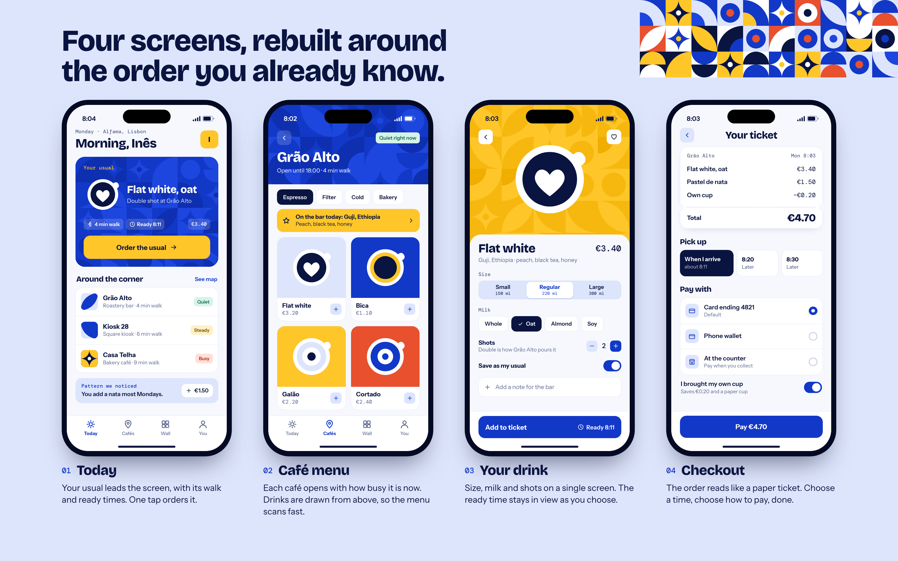
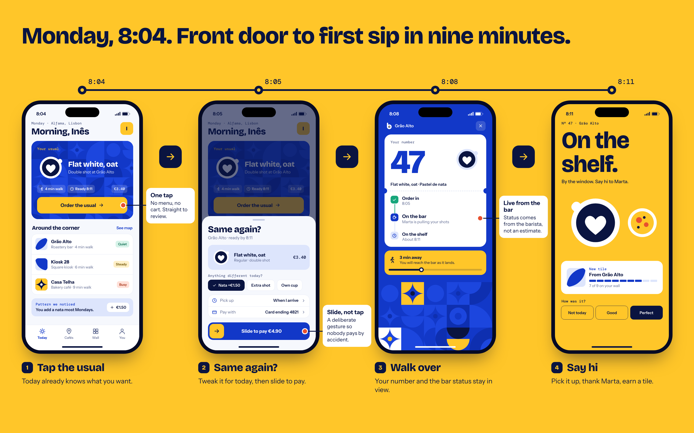
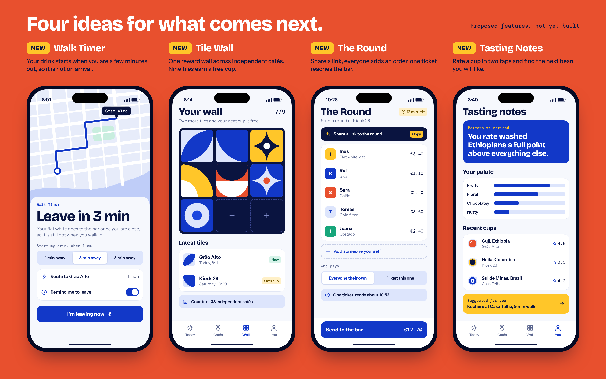
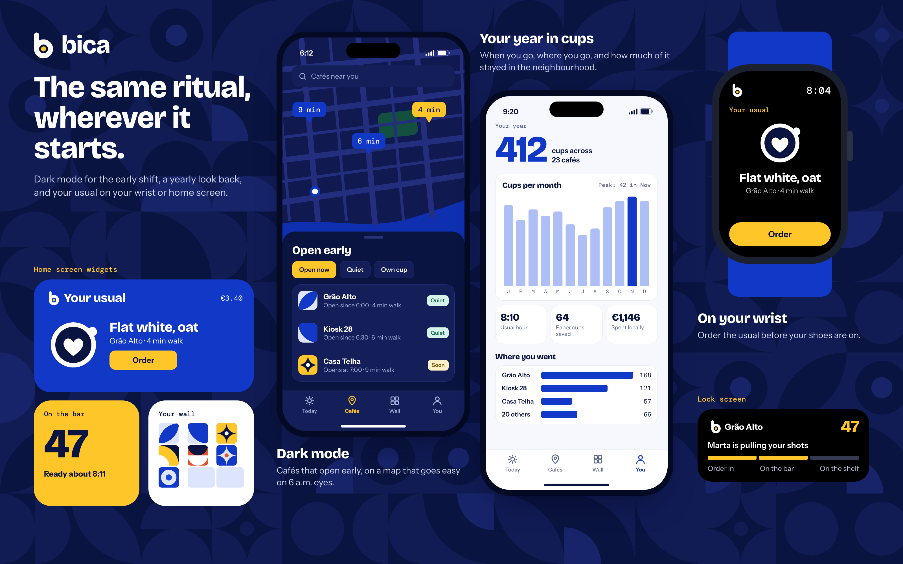

# Bica

**Skip the line. Keep the hello.**

> **This is a product concept.** Bica is not published on the App Store or Google Play, and there is no working app behind these screens. It is a redesign based on an earlier project. Every café, person, price and number shown is fictional.

## Introduction

Bica is a pre-ordering app for independent cafés. The name comes from Lisbon, where a bica is the short espresso people order at the counter, often without needing to say much. The concept takes that feeling of being a regular and puts it on your phone: your order is remembered and ready when you arrive, and you still get to talk to the person who made it.

## What it does

- Keeps your usual order at the top of the app, one tap away.
- Lists nearby cafés with walking time and how busy each one is right now.
- Lets you set size, milk and shots while the ready time stays in view.
- Lets you choose when to collect and whether to pay by card, phone wallet or at the counter.
- Gives you a ticket number and live status from the bar until your order is on the shelf.

## The problem

Regulars repeat the same order to the same person, after waiting in the same morning queue. Large chains solved the queue with their own apps. Independent cafés rarely have one, so their customers either wait or walk to a chain, and their loyalty cards stay scattered across a wallet.

Most ordering apps also fix the wrong thing. They treat the café as a pickup point: pay, grab, leave. For a neighbourhood café, the conversation at the counter is a large part of why people come back. Bica removes the wait and leaves that part alone.

## Who it's for

- **Regulars with a fixed routine**, who order the same drink and are short on time in the morning.
- **Neighbourhood explorers**, who like trying different independent cafés and want one app for all of them.
- **Small teams**, who buy a round and are tired of collecting orders in a group chat.
- **Café owners**, who want a calmer morning rush without losing contact with their customers.

## Main features (redesigned)

**Today.** The home screen is built around one decision: the same again, or something else? Your usual leads, with its walk and ready times beside it. Nearby cafés follow, each marked Quiet, Steady or Busy.

**Café menu.** Each café opens with how busy it is and what is on the bar today. Drinks are drawn from above in a consistent style, so the menu can be scanned without reading every label.

**Your drink.** Size, milk and shots fit on one screen, with no steps to page through. Any combination can be saved as your new usual.

**Checkout.** The order reads like a paper ticket, then asks two questions: when do you want it, and how do you want to pay?

The key journey is an ordinary Monday: from the front door to the first sip in nine minutes. Three decisions shape it:

- **One tap to review.** The usual skips the menu and cart and goes straight to a short "Same again?" sheet, where one-off changes such as an extra shot are a single tap.
- **Slide to pay.** Ordering takes so little effort that paying needs a deliberate gesture, so nobody pays by accident.
- **Status from the bar.** The ticket shows what the barista has actually done with the order, rather than an estimate, and it names the person making it.

## New proposed features

> **These are proposals only.** None of the features in this section are implemented. They show where the product could go next.

- **Walk Timer (proposal).** Your drink goes to the bar when you are a chosen number of minutes away, so it is still hot when you walk in.
- **Tile Wall (proposal).** A single rewards wall across independent cafés. Each visit adds a tile from that café, and nine tiles earn a free cup.
- **The Round (proposal).** Share a link, everyone adds their own order, and one ticket reaches the bar. Each person can pay for themselves, or one person can cover it.
- **Tasting Notes (proposal).** Rate a cup in two taps. Over time the app shows a "Pattern we noticed" and a "Suggested for you" pointing to beans you are likely to enjoy.

The same proposals extend beyond the main app:

- **Dark mode (proposal)**, for the early shift.
- **Your year in cups (proposal)**, a yearly look at when you went, where you went and how many paper cups you saved.
- **Watch app, widgets and lock screen status (proposal)**, so you can order the usual or check your ticket without opening the app.

## From prototype to product

| Area | In this concept | Needed for a real product |
| --- | --- | --- |
| Cafés | Fictional cafés and menus | A pilot with a small group of cafés in one neighbourhood |
| At the bar | Live status, seen from the customer's side | A simple way for baristas to accept, pace and finish orders during a rush |
| Payments | Card, phone wallet and counter flows | A licensed payment provider, receipts, refunds and a policy for orders nobody collects |
| Walk Timer | A designed flow | Clear location consent, plain privacy wording and testing against real walks |
| Tile Wall | A designed rewards model | An agreement on who pays for a free cup earned across several cafés |
| Validation | No user testing yet | Interviews with regulars and owners, plus prototype tests of one-tap ordering and slide to pay |

## The concept and its value

For regulars, Bica gives back the time spent queueing without taking away the part of the morning they like. For independent cafés, it offers the convenience customers already get from large chains, while keeping the counter at the centre. For the neighbourhood, it gives people a reason to keep spending locally.

The visual identity comes from a Lisbon street: cobalt azulejo tiles, yellow trams, terracotta roofs and limewashed walls. The tile is the system's basic unit, appearing in patterns, in the rewards wall and in each café's mark. The logo is a cup seen from above, with its handle forming the stem of the b, and every drink in the app is drawn from that same angle. Headlines use Bricolage Grotesque, the interface uses Instrument Sans, and tickets, times and prices use DM Mono, as a nod to printed receipts.

**Palette**

| Colour | HEX | Role |
| --- | --- | --- |
| Azulejo | `#1238C8` | Brand, primary actions |
| Noite | `#0A1440` | Text, dark mode |
| Elétrico | `#FFC629` | Accent, order actions |
| Telha | `#E8502E` | Busy states, highlights |
| Jardim | `#17A67B` | Quiet states, success |
| Pedra | `#5C678F` | Secondary text |
| Névoa | `#DDE5FC` | Chips, surfaces |
| Cal | `#F6F8FD` | App background |

---

Product concept by Ziad Abdellah.
